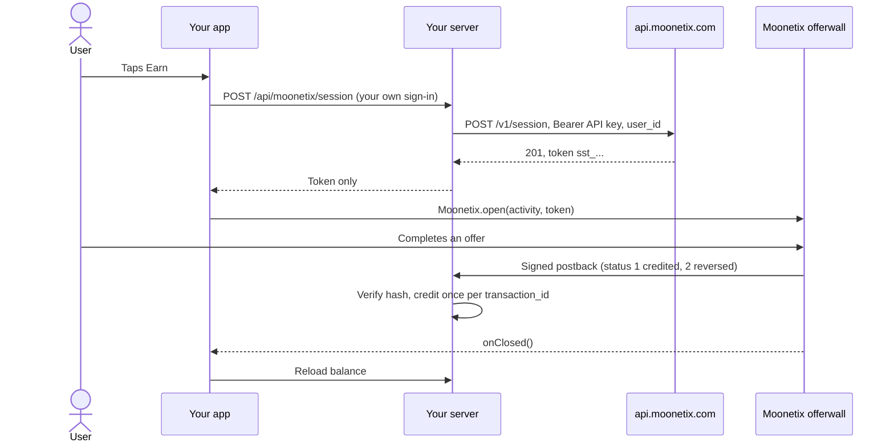

# Moonetix Offerwall SDK for Android

**Open the Moonetix offerwall in your Android app with one call, from a single-use token your server creates.**

[](https://github.com/moonetix/moonetix-android-sdk/actions/workflows/ci.yml)
[](https://moonetix.com)
[](LICENSE)
[](https://docs.moonetix.com/android-sdk#install)
[](https://docs.moonetix.com/android-sdk)
[](https://moonetix.com/register?from=github-moonetix-android-sdk)
[](https://moonetix.com/integrations/android)

This is the source of the [Moonetix](https://moonetix.com) Android SDK. It opens the offerwall in a locked-down WebView screen, sends offer links to the Play Store or the browser, and reports a few events to your app. Moonetix is an affiliate network: your users earn your own currency by completing offers, and you earn per completed offer.

The code here is the released 2.0.1 source, kept for reading and auditing. Apps should depend on the Maven artifact.

> **Get your App ID and API key: sign up free at https://moonetix.com/register?from=github-moonetix-android-sdk**

## Design choices

1. **No key in the APK.** The app only ever holds a session token that works once and expires after 10 minutes. The API key and link hash salt stay on your server.
2. **Small and auditable.** Kotlin standard library only: no AndroidX, no AppCompat, no reflection, no JavaScript bridge. Read the link policy and WebView settings yourself before you ship.
3. **Tested where it matters.** 57 JVM unit tests cover the URL policy, token and App ID checks, branding parsing and contrast rules.

## Flow



## Quick start

### 1. Install

Add the Moonetix Maven repository and the dependency:

```kotlin
// settings.gradle.kts
dependencyResolutionManagement {
    repositories {
        google()
        mavenCentral()
        maven { url = uri("https://moonetix.com/maven") }
    }
}

// app/build.gradle.kts
dependencies {
    implementation("com.moonetix:offerwall:2.0.1")
}
```

Groovy:

```groovy
// settings.gradle
dependencyResolutionManagement {
    repositories {
        google()
        mavenCentral()
        maven { url 'https://moonetix.com/maven' }
    }
}

// app/build.gradle
dependencies {
    implementation 'com.moonetix:offerwall:2.0.1'
}
```

- Older projects list their repositories under `allprojects` in the top-level `build.gradle`. Add the Moonetix line there instead.
- The SDK adds the internet permission and its offerwall screen to your app's manifest by itself.
- It brings its own R8 and ProGuard rules, so you do not need to add any.

Requirements: Android 5.0 (API 21) or newer, with Android System WebView or Chrome on the device.

### 2. Add a token endpoint to your server

Your app never calls `POST https://api.moonetix.com/v1/session` itself, because that needs the API key. Add one endpoint to your own server. It checks who is signed in, asks Moonetix for a session for that user, and returns only the token. Node.js, from the [docs](https://docs.moonetix.com/android-sdk#token-endpoint) (PHP and Python are there too):

```js
app.post('/api/moonetix/session', requireLogin, async (req, res) => {
  try {
    const r = await fetch('https://api.moonetix.com/v1/session', {
      method: 'POST',
      headers: {
        Authorization: `Bearer ${process.env.MOONETIX_API_KEY}`,
        'Content-Type': 'application/json',
      },
      body: JSON.stringify({ user_id: String(req.user.id) }),
      signal: AbortSignal.timeout(10000),
    });
    const data = await r.json().catch(() => ({}));
    if (r.status === 201 && data.token) {
      return res.json({ token: data.token });
    }
    console.warn('Moonetix session failed', r.status, data.error);
    return res.status(r.status === 403 ? 403 : 503).json({ error: 'offerwall_unavailable' });
  } catch (e) {
    return res.status(503).json({ error: 'offerwall_unavailable' });
  }
});
```

Put the API key in the server environment only (see [`.env.example`](.env.example)). The API key is on the API page of your dashboard.

A runnable version with tests, for every Moonetix SDK, is in [moonetix-ios-sdk/token-endpoint](https://github.com/moonetix/moonetix-ios-sdk/tree/main/token-endpoint).

| Status | `error` | Meaning |
| --- | --- | --- |
| 201 | | Session created. Pass `token` to the app. |
| 400 | `invalid_user_id` | `user_id` is missing or has characters that are not allowed. |
| 401 | `invalid_api_key` | The API key is missing or wrong. |
| 403 | `app_not_live`, `user_blocked` | The app is paused, or this user is blocked. Do not show the offerwall. |
| 429 | `rate_limited` | More than 600 requests in a minute for this app. Retry after `Retry-After`. |

### 3. Open the offerwall

Call `init` once, for example in your `Application` class, with the App ID from the Integration section. Then open the offerwall with a fresh token from your server. Call all Moonetix methods from the main thread.

```kotlin
// Kotlin
Moonetix.init(applicationContext, "YOUR_APP_ID")
Moonetix.open(activity, token)

// your own title
Moonetix.open(activity, token, MoonetixOptions(title = "Earn coins"))
```

```java
// Java
Moonetix.init(getApplicationContext(), "YOUR_APP_ID");
Moonetix.open(activity, token);
```

`open` never throws for offerwall problems. They arrive as events.

| `MoonetixOptions` | Default | Effect |
| --- | --- | --- |
| `title` | `null` | Top bar text. `null` uses the title from the Design section, or "Earn rewards". |
| `toolbarColor` | `null` | ARGB color such as `0xFF004ABB.toInt()`. `null` uses the Design section, or a light or dark neutral that follows the system theme. Text and the close icon keep a 4.5:1 contrast either way. |
| `showLogo` | `true` | Show the Moonetix mark next to the title |

`Moonetix.VERSION` holds the SDK version, sent to the wall as `sdk=android-2.0.1`.

## Events

```kotlin
Moonetix.setListener(object : MoonetixListener {
    override fun onOpened() { }
    override fun onClosed() { refreshBalanceFromServer() }
    override fun onError(error: MoonetixError) { Log.w("Earn", "${error.code}: ${error.message}") }
})
```

All callbacks are optional and run on the main thread. The listener is stored in a static field: set it from a long-lived object, or call `Moonetix.setListener(null)` in `onDestroy()`.

| Event | When |
| --- | --- |
| `onOpened()` | The offerwall finished loading its first page. |
| `onClosed()` | The offerwall screen closed. Once per `open`. Reload the user's balance from your server here. |
| `onError(error)` | One of the codes below. |

| `MoonetixError.Code` | Meaning |
| --- | --- |
| `NOT_INITIALIZED` | `open` was called before `init`. |
| `INVALID_APP_ID` | `init` received something that is not a 24-character lowercase hex App ID. |
| `INVALID_TOKEN` | The token is malformed, or the server does not know it (HTTP 404). |
| `TOKEN_EXPIRED_OR_USED` | The token is older than 10 minutes or was already used (HTTP 410). Create a new session. |
| `NETWORK` | The offerwall could not be reached. The screen shows a Try again button. |
| `UNKNOWN` | Anything else, for example Android System WebView is missing or crashed. |

Events are for your user interface only. Credit rewards from the signed postback on your server, never from an event.

## Troubleshooting

| What you see | Cause and fix |
| --- | --- |
| `INVALID_APP_ID`: "The app ID passed to Moonetix.init() is invalid" | The value is not the 24-character lowercase hex App ID. Passing the API key here is the usual mistake. |
| `INVALID_TOKEN` right after `open` | You passed the whole JSON answer or an empty string. Pass only the `token` field, which starts with `sst_`. |
| `INVALID_TOKEN` after the screen opened (HTTP 404) | The token was created with the API key of another app than the App ID in `init`. Use the App ID and API key of the same app. |
| `TOKEN_EXPIRED_OR_USED` (HTTP 410) | The token is older than 10 minutes, or the app opened it twice. Request a new token on every tap. |
| Your endpoint gets 401 `invalid_api_key` or 403 `app_not_live` from `/v1/session` | Wrong API key, or the app is paused or not approved yet. Hide the Earn button until the endpoint returns a token. |
| `UNKNOWN`: "Android System WebView is not available on this device." | Install or update Android System WebView or Chrome on the device. |
| A "VPN detected" page instead of offers | The device is on a VPN, a proxy or a cloud network. Test on a normal home or mobile connection. |

## Inside the SDK

1. `Moonetix.init` checks the App ID format and keeps the application context.
2. `Moonetix.open` checks the token format (`sst_` plus 43 characters) and starts `MoonetixActivity`. The token is never logged, never put in an Intent extra and never saved in the instance state.
3. The activity loads `https://wall.moonetix.com/{appId}?token=...` once. Rotation, dark mode and keyboard changes do not reload it, and after a low-memory restart the screen resumes the wall instead of reusing the token.
4. `LinkPolicy` decides every navigation: only `https://wall.moonetix.com` stays inside. Play links open the Play Store, `intent:` links open the target app with a safe fallback, other sites open in the browser, and `javascript:`, `file:`, `content:` and `data:` are blocked.
5. In parallel, `BrandLoader` fetches your title and colors from the Design section and keeps them for 10 minutes. The logo is accepted only from `moonetix.com` and `wall.moonetix.com`. Text that would fall below a 4.5:1 contrast ratio is switched to black or white.
6. Rewards never pass through the app. Moonetix calls your postback URL, and your server credits the user.

| Path | Purpose |
| --- | --- |
| `offerwall/src/main/kotlin/com/moonetix/offerwall/Moonetix.kt` | Public API: `init`, `open`, `setListener` |
| `offerwall/src/main/kotlin/com/moonetix/offerwall/MoonetixActivity.kt` | The offerwall screen and WebView settings |
| `offerwall/src/main/kotlin/com/moonetix/offerwall/internal/LinkPolicy.kt` | Where each URL is handled |
| `offerwall/src/main/kotlin/com/moonetix/offerwall/internal/ExternalLauncher.kt` | Play Store, `intent:` and browser launches |
| `offerwall/src/main/kotlin/com/moonetix/offerwall/internal/Brand*.kt`, `BarStyle.kt` | Branding and contrast |
| `offerwall/src/test/` | JVM unit tests |

## Security

- Create sessions on your server only. Never put the API key or the link hash salt in your app: anyone can read an APK's files.
- Take the user ID from your own sign-in, never from the request. Otherwise anyone could open the offerwall as someone else.
- Return only the token to the app. Never pass the API key or the full Moonetix response on.
- Do not keep tokens for later. Create a new one each time the user taps Earn.
- Credit rewards only from the signed server-to-server postback: verify the hash with a constant-time comparison first, credit each `transaction_id` once, and let status 2 take back only what was credited. See [offerwall-postback-handlers](https://github.com/moonetix/offerwall-postback-handlers).
- The WebView has no file or content access, no mixed content, Safe Browsing on, geolocation and web permission requests denied, and no JavaScript interface. Remote debugging is on only in debuggable builds of your app.
- Reward users only for completed offers. Never reward joins, invites, likes, reviews or other engagement. Users must be 16 or older.

## Building and testing

### From source

You need JDK 17 and the Android SDK (platform 36). Set `ANDROID_HOME`, or `sdk.dir` in `local.properties`.

```bash
./gradlew :offerwall:testDebugUnitTest :offerwall:lintRelease :offerwall:assembleRelease
./gradlew :offerwall:publishReleasePublicationToLocalRepository   # writes build/repo
```

### Against a live offerwall

1. Create a session for a test user from your server, and open it in a debug build on a phone or emulator.
2. Check that the offerwall opens, that an offer opens in the Play Store or the browser, and that back and close work.
3. In the dashboard, open Offerwalls, your offerwall, Integration, and click **Send a test postback**. You can also send one from the Postback page. Send status 1, then status 2 for the same user, and check that the balance goes up and back down.
4. Test on a normal home or mobile connection. On a VPN, a proxy or a cloud device the offerwall shows a block page instead of offers.

Clicks through the SDK show as `sdk` in the `{integration}` postback macro and as Mobile SDK in your dashboard. For other problems, see [Troubleshooting](https://docs.moonetix.com/android-sdk#troubleshooting) and [Testing](https://docs.moonetix.com/testing).

## Learn more

- Docs: [Android SDK](https://docs.moonetix.com/android-sdk), [Postbacks](https://docs.moonetix.com/postbacks), [Credits and reversals](https://docs.moonetix.com/credits-and-reversals), [Testing](https://docs.moonetix.com/testing)
- Academy: [How to Add an Offerwall to an Android App (Kotlin)](https://moonetix.com/academy/integrations/android-offerwall-kotlin)
- Academy: [How to Test Your App Before It Goes Live](https://moonetix.com/academy/integrations/test-your-app-before-launch)
- Moonetix for Android: [moonetix.com/integrations/android](https://moonetix.com/integrations/android)
- Moonetix for apps: [moonetix.com/industries/apps](https://moonetix.com/industries/apps)

## Get started

**Sign up free at https://moonetix.com/register?from=github-moonetix-android-sdk.** Publisher applications are reviewed by hand. After approval, add your app, set the currency name and rate, and put the API key in your server environment. The App ID goes in `Moonetix.init`.

## More Moonetix examples

All on [github.com/moonetix](https://github.com/moonetix).

**SDKs**

- [moonetix-ios-sdk](https://github.com/moonetix/moonetix-ios-sdk): iOS SDK install guide, SwiftUI sample and token endpoint
- [moonetix-flutter](https://github.com/moonetix/moonetix-flutter): Flutter plugin source
- [moonetix-react-native](https://github.com/moonetix/moonetix-react-native): React Native and Expo package source
- [moonetix-unity](https://github.com/moonetix/moonetix-unity): Unity plugin source

**Server side**

- [offerwall-postback-handlers](https://github.com/moonetix/offerwall-postback-handlers): postback handlers for common languages
- [offerwall-express](https://github.com/moonetix/offerwall-express), [offerwall-laravel](https://github.com/moonetix/offerwall-laravel), [offerwall-django](https://github.com/moonetix/offerwall-django)
- [offerwall-firebase-functions](https://github.com/moonetix/offerwall-firebase-functions), [offerwall-supabase](https://github.com/moonetix/offerwall-supabase)

**Web and apps**

- [offerwall-nextjs-starter](https://github.com/moonetix/offerwall-nextjs-starter), [offerwall-react-vite](https://github.com/moonetix/offerwall-react-vite), [offerwall-vue-nuxt](https://github.com/moonetix/offerwall-vue-nuxt)
- [rewards-site-starter](https://github.com/moonetix/rewards-site-starter), [moonetix-offerwall-wordpress](https://github.com/moonetix/moonetix-offerwall-wordpress)
- [offerwall-flutter-example](https://github.com/moonetix/offerwall-flutter-example), [offerwall-react-native-example](https://github.com/moonetix/offerwall-react-native-example)
- [offerwall-chrome-extension](https://github.com/moonetix/offerwall-chrome-extension), [offerwall-electron](https://github.com/moonetix/offerwall-electron)

**Games and communities**

- [offerwall-unity-example](https://github.com/moonetix/offerwall-unity-example), [offerwall-godot](https://github.com/moonetix/offerwall-godot), [offerwall-html5-game](https://github.com/moonetix/offerwall-html5-game)
- [telegram-mini-app-offerwall](https://github.com/moonetix/telegram-mini-app-offerwall), [discord-rewards-bot](https://github.com/moonetix/discord-rewards-bot)
- [awesome-offerwalls](https://github.com/moonetix/awesome-offerwalls): a curated list of offerwall resources

## License

Apache License 2.0. See [LICENSE](LICENSE).
